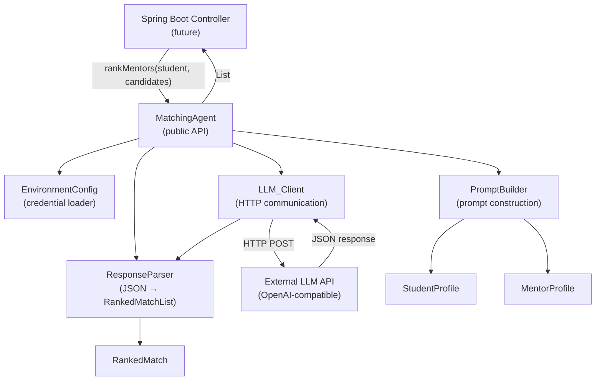
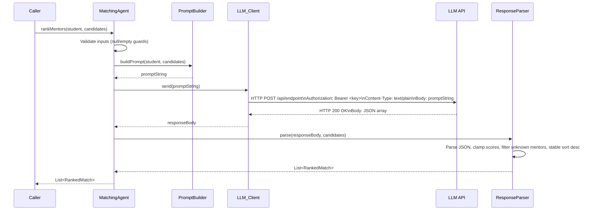

# Design Document

## Overview

The AI Matching Agent is a self-contained Java component that accepts a `StudentProfile` and a list of `MentorProfile` objects, constructs a structured prompt, calls an OpenAI-compatible LLM API via HTTP, parses the JSON response, and returns a ranked list of compatible mentors sorted by descending compatibility score.

The agent is designed as a single deployable class (`MatchingAgent`) with collaborating POJOs and helper classes, all within the `com.hackohio.matching` package. It plugs into the existing Spring Boot application via its no-argument constructor, which reads all configuration from OS environment variables.

**Key design goals:**

- Zero secrets in source code — all credentials from environment variables
- Works with any OpenAI-compatible endpoint (OpenAI, Ollama, Groq, etc.)
- Pure Java with minimal external dependencies (Jackson for JSON, Java 11 `HttpClient`)
- Deterministic, reproducible prompt construction
- Clear typed exceptions for every failure mode

---

## Architecture

### Component Diagram



### Package Structure

```
com.hackohio.matching/
├── MatchingAgent.java          # Public entry point + orchestration
├── MatchingAgentDemo.java      # Runnable demo (main method)
├── MatchingAgentException.java # Typed runtime exception
├── model/
│   ├── StudentProfile.java     # Student POJO
│   ├── MentorProfile.java      # Mentor POJO
│   └── RankedMatch.java        # Mentor + score pair
└── internal/
    ├── EnvironmentConfig.java  # Env var loading + validation
    ├── PromptBuilder.java      # Prompt string construction
    ├── LLM_Client.java         # HTTP client wrapper
    └── ResponseParser.java     # JSON parsing + score clamping
```

All `internal/` classes are package-private. Only `MatchingAgent`, the `model/` classes, `MatchingAgentDemo`, and `MatchingAgentException` are `public`.

### File Layout (Maven project)

```
HackOHIO/
├── pom.xml
└── src/
    └── main/
        └── java/
            └── com/hackohio/matching/
                ├── MatchingAgent.java
                ├── MatchingAgentDemo.java
                ├── MatchingAgentException.java
                ├── model/
                │   ├── StudentProfile.java
                │   ├── MentorProfile.java
                │   └── RankedMatch.java
                └── internal/
                    ├── EnvironmentConfig.java
                    ├── PromptBuilder.java
                    ├── LLM_Client.java
                    └── ResponseParser.java
```

---

## Components and Interfaces

### MatchingAgent

The public façade. Owns an `EnvironmentConfig`, `PromptBuilder`, `LLM_Client`, and `ResponseParser`. All collaborators are instantiated in the constructor for testability (constructor injection overload) while also providing the no-arg constructor for Spring Boot.

```java
public class MatchingAgent {
    // No-arg constructor for Spring Boot DI — reads config from env vars
    public MatchingAgent()

    // Package-private constructor for testing — accepts injected collaborators
    MatchingAgent(EnvironmentConfig config, PromptBuilder builder,
                  LLM_Client client, ResponseParser parser)

    // Primary public method
    public List<RankedMatch> rankMentors(StudentProfile student,
                                         List<MentorProfile> candidates)
}
```

**`rankMentors` contract:**

| Precondition violation | Exception |
|---|---|
| `student == null` | `IllegalArgumentException("StudentProfile must not be null")` |
| `candidates == null` | `IllegalArgumentException("Candidates list must not be null")` |
| `candidates` contains a null entry at index `i` | `IllegalArgumentException("Candidates list contains null entry at index i")` |
| `candidates` is empty | Returns `Collections.emptyList()` immediately (no API call) |

### EnvironmentConfig

Reads and validates environment variables at construction time. Throws `IllegalStateException` for any invalid configuration before any network call is possible.

```java
class EnvironmentConfig {
    String getApiKey()      // value of LLM_API_KEY
    String getApiUrl()      // value of LLM_API_URL
    int    getTimeoutSeconds() // value of LLM_REQUEST_TIMEOUT_SECONDS, default 30
}
```

### PromptBuilder

Stateless — all methods are pure functions. Takes profile objects and returns a `String`. Throws `IllegalArgumentException` for invalid inputs without producing partial output.

```java
class PromptBuilder {
    String buildPrompt(StudentProfile student, List<MentorProfile> mentors)
}
```

### LLM_Client

Wraps Java 11's `java.net.http.HttpClient`. Sends the prompt as an HTTP POST and returns the raw response body string.

```java
class LLM_Client {
    LLM_Client(EnvironmentConfig config)
    String send(String prompt) throws MatchingAgentException
}
```

### ResponseParser

Parses the raw LLM response body into a `List<RankedMatch>`. Applies score clamping, unknown-mentor filtering, and stable descending sort.

```java
class ResponseParser {
    ResponseParser(ObjectMapper mapper)   // Jackson ObjectMapper injected
    List<RankedMatch> parse(String responseBody,
                            List<MentorProfile> candidates)
        throws MatchingAgentException
}
```

### MatchingAgentException

Unchecked exception used for all agent-level failures (HTTP errors, parse errors, network timeouts).

```java
public class MatchingAgentException extends RuntimeException {
    public MatchingAgentException(String message)
    public MatchingAgentException(String message, Throwable cause)
    public int getHttpStatusCode()   // -1 if not an HTTP error
}
```

---

## Data Models

### StudentProfile

```java
public class StudentProfile {
    private final String id;               // required, non-blank
    private final List<String> interests;  // tags, may be empty
    private final List<String> desiredSkills; // skills to learn, may be empty
    private final String careerGoal;       // free text, may be empty

    // Constructor validates id — throws IllegalArgumentException if blank/null
    public StudentProfile(String id, List<String> interests,
                          List<String> desiredSkills, String careerGoal)

    // Getters
    public String getId()
    public List<String> getInterests()
    public List<String> getDesiredSkills()
    public String getCareerGoal()

    // Combined list for PromptBuilder — preserves duplicates
    public List<String> getAllTags()  // interests + desiredSkills concatenated
}
```

### MentorProfile

```java
public class MentorProfile {
    private final String id;                    // required, non-blank
    private final String displayName;           // human-readable name
    private final List<String> expertiseTags;   // domain tags, may be empty
    private final List<String> teachableSkills; // skills they can teach
    private final String professionalBackground; // free text, may be empty

    // Constructor validates id — throws IllegalArgumentException if blank/null
    public MentorProfile(String id, String displayName,
                         List<String> expertiseTags,
                         List<String> teachableSkills,
                         String professionalBackground)

    // Getters
    public String getId()
    public String getDisplayName()
    public List<String> getExpertiseTags()
    public List<String> getTeachableSkills()
    public String getProfessionalBackground()

    // Combined list for PromptBuilder — preserves duplicates
    public List<String> getAllTags()  // expertiseTags + teachableSkills concatenated
}
```

### RankedMatch

```java
public class RankedMatch {
    private final MentorProfile mentor;
    private final int score;   // 0–100 inclusive (clamped by parser)

    public RankedMatch(MentorProfile mentor, int score)
    public MentorProfile getMentor()
    public int getScore()
}
```

### Field Type Summary

| Class | Field | Java Type | Constraint |
|---|---|---|---|
| StudentProfile | id | String | non-null, non-blank |
| StudentProfile | interests | List\<String\> | non-null, elements non-null |
| StudentProfile | desiredSkills | List\<String\> | non-null, elements non-null |
| StudentProfile | careerGoal | String | non-null |
| MentorProfile | id | String | non-null, non-blank |
| MentorProfile | displayName | String | non-null |
| MentorProfile | expertiseTags | List\<String\> | non-null, elements non-null |
| MentorProfile | teachableSkills | List\<String\> | non-null, elements non-null |
| MentorProfile | professionalBackground | String | non-null |
| RankedMatch | mentor | MentorProfile | non-null |
| RankedMatch | score | int | 0–100 inclusive |

---

## API Communication Flow

### Sequence Diagram



### HTTP Request Format

```
POST {LLM_API_URL}
Authorization: Bearer {LLM_API_KEY}
Content-Type: text/plain

{prompt string}
```

### Environment Variable Reference

| Variable | Required | Default | Description |
|---|---|---|---|
| `LLM_API_KEY` | Yes | — | Bearer token for the LLM API |
| `LLM_API_URL` | Yes | — | Full endpoint URL (must start with `http://` or `https://`) |
| `LLM_REQUEST_TIMEOUT_SECONDS` | No | 30 | Request timeout; valid range 1–300 |

---

## Prompt Format

The `PromptBuilder` produces the following deterministic template. Fields are inserted in declaration order; lists are joined with `, ` (comma-space). The template is stable across JVM invocations.

```
You are a mentor-matching assistant. Evaluate compatibility between the student and each mentor.
Return ONLY a JSON array. Each element must contain exactly two fields:
  "mentorId" (string matching one of the provided mentor IDs) and
  "score" (integer 0–100, where 100 is a perfect match).
Do not include any explanation or text outside the JSON array.

=== STUDENT ===
Interests: {interest1}, {interest2}, ...
Desired Skills: {skill1}, {skill2}, ...
Career Goal: {careerGoal}

=== MENTOR: {mentor.id} ===
Name: {mentor.displayName}
Expertise: {tag1}, {tag2}, ...
Teachable Skills: {skill1}, {skill2}, ...
Background: {mentor.professionalBackground}

=== MENTOR: {mentor2.id} ===
...

Return the JSON array now:
```

When the mentor list is empty the mentor blocks are omitted and the instructions direct the LLM to return `[]`.

### Expected JSON Response Schema

```json
[
  { "mentorId": "mentor-abc", "score": 87 },
  { "mentorId": "mentor-xyz", "score": 54 }
]
```

The parser extracts the outermost JSON array, mapping `mentorId` → mentor lookup and `score` → integer. Scores are clamped to [0, 100]. Entries referencing unknown mentor IDs or missing required fields are silently dropped.

---

## Correctness Properties

*A property is a characteristic or behavior that should hold true across all valid executions of a system — essentially, a formal statement about what the system should do. Properties serve as the bridge between human-readable specifications and machine-verifiable correctness guarantees.*

### Property 1: getAllTags returns concatenation of both source lists

*For any* `StudentProfile` (or `MentorProfile`) constructed with arbitrary non-null interest/skill (or expertise/teachable) lists, `getAllTags()` SHALL return a list equal to the concatenation of those two source lists in declaration order, preserving duplicates and element order.

**Validates: Requirements 1.4, 1.5**

---

### Property 2: Invalid identifier rejection

*For any* string that is null, empty, or composed entirely of whitespace characters, constructing a `StudentProfile` or `MentorProfile` with that string as the identifier SHALL throw an `IllegalArgumentException`.

**Validates: Requirements 1.3**

---

### Property 3: Prompt determinism

*For any* `StudentProfile` and list of `MentorProfile` objects, calling `PromptBuilder.buildPrompt` multiple times with the same inputs SHALL produce byte-for-byte identical strings.

**Validates: Requirements 3.5**

---

### Property 4: Prompt completeness

*For any* non-empty list of `MentorProfile` objects and a valid `StudentProfile`, the prompt produced by `PromptBuilder.buildPrompt` SHALL contain each mentor's identifier, and the student's interests, desired skills, and career goal as distinct labeled sections.

**Validates: Requirements 3.1, 3.2**

---

### Property 5: Score clamping round-trip

*For any* JSON response array where a score field value is an arbitrary integer (including values outside [0, 100]), `ResponseParser.parse` SHALL return a `RankedMatchList` where every entry's `CompatibilityScore` is in the range [0, 100] inclusive.

**Validates: Requirements 5.2**

---

### Property 6: Unknown mentor exclusion

*For any* JSON response array containing mentor identifiers, `ResponseParser.parse` SHALL include in the returned list only entries whose `mentorId` matches an identifier present in the original candidates list.

**Validates: Requirements 5.4**

---

### Property 7: Descending sort stability

*For any* parsed `RankedMatchList`, the entries SHALL be ordered by descending `CompatibilityScore`, and entries with equal scores SHALL appear in the same relative order as in the original JSON response.

**Validates: Requirements 5.6**

---

### Property 8: Empty candidates short-circuit

*For any* valid `StudentProfile`, calling `rankMentors` with an empty candidates list SHALL return an empty list without making any HTTP request.

**Validates: Requirements 6.4**

---

## Error Handling

### Error Taxonomy

| Error source | Exception type | Message contract |
|---|---|---|
| Blank/null profile ID | `IllegalArgumentException` | "Identifier must not be null or blank" |
| Null StudentProfile | `IllegalArgumentException` | "StudentProfile must not be null" |
| Null candidates list | `IllegalArgumentException` | "Candidates list must not be null" |
| Null entry in candidates | `IllegalArgumentException` | "Candidates list contains null entry at index {i}" |
| Missing `LLM_API_KEY` | `IllegalStateException` | "LLM_API_KEY is not set" |
| Missing `LLM_API_URL` | `IllegalStateException` | "LLM_API_URL is not set" |
| Invalid `LLM_API_URL` scheme | `IllegalStateException` | "LLM_API_URL is not a valid URL" |
| HTTP non-200 response | `MatchingAgentException` | "LLM API returned HTTP {status}: {body}" |
| Network timeout | `MatchingAgentException` | "LLM API request timed out" (cause = original exception) |
| Connection error | `MatchingAgentException` | "LLM API connection error" (cause = original exception) |
| JSON parse failure | `MatchingAgentException` | "Failed to parse LLM response: {first 500 chars}" |
| PromptBuilder missing field | `IllegalArgumentException` | "StudentProfile.{fieldName} must not be null or empty" |

### Secret Safety

`LLM_API_KEY` value is **never** included in any exception message, log statement, or `toString()` output at any level. All references in error messages use the variable name only.

### Retry Policy

No automatic retries in the initial implementation. The caller (Spring Boot controller) is responsible for retry logic. `MatchingAgentException` preserves the HTTP status code via `getHttpStatusCode()` so the controller can decide whether to retry (5xx) or fail fast (4xx).

---

## Testing Strategy

### Unit Tests (JUnit 5 + Mockito)

Each class is tested in isolation with mocked collaborators.

- **StudentProfile / MentorProfile**: Constructor validation, `getAllTags()` concatenation, empty-list edge cases.
- **EnvironmentConfig**: Tests run with a mock environment provider (not real `System.getenv`) to avoid test pollution. Covers all missing/blank/invalid scenarios.
- **PromptBuilder**: Determinism (call twice, compare), completeness (all fields appear), empty-mentor case, missing-student-field rejection.
- **ResponseParser**: Score clamping at boundaries (−1 → 0, 101 → 100, 0, 100 pass-through), unknown-ID filtering, missing-field row skipping, stable sort with ties, malformed JSON exception.
- **MatchingAgent**: Null-guard branches, empty-candidates short-circuit, integration of collaborators via Mockito mocks.

### Property-Based Tests (jqwik)

Each property test is tagged with a comment in the format:
`// Feature: ai-matching-agent, Property {N}: {property_text}`
and configured to run a minimum of 100 tries per property.

- **Property 1** — generate arbitrary `List<String>` for interests and desiredSkills; assert `getAllTags()` equals concatenation.
- **Property 2** — generate blank/null/whitespace strings; assert constructor throws.
- **Property 3** — generate arbitrary profiles; assert two successive `buildPrompt` calls produce identical strings.
- **Property 4** — generate profiles with at least one mentor; assert prompt contains each mentor ID and student fields.
- **Property 5** — generate JSON arrays with random integer scores; assert all parsed scores are in [0, 100].
- **Property 6** — generate JSON arrays with random mentor IDs (mix of known and unknown); assert only known IDs appear in the result.
- **Property 7** — generate arbitrary score lists; assert result is sorted descending with stable tie-breaking.
- **Property 8** — generate arbitrary valid students; assert `rankMentors(student, emptyList)` returns empty without HTTP call.

### Integration Test

One end-to-end test (`MatchingAgentIntegrationTest`) that uses [WireMock](https://wiremock.org/) to stub the LLM API endpoint. It verifies the full `rankMentors` call path: prompt sent → mock JSON returned → `RankedMatch` list constructed and sorted correctly.

### Dependencies

**Maven `pom.xml` additions:**

```xml
<!-- Jackson for JSON parsing -->
<dependency>
  <groupId>com.fasterxml.jackson.core</groupId>
  <artifactId>jackson-databind</artifactId>
  <version>2.17.1</version>
</dependency>

<!-- JUnit 5 -->
<dependency>
  <groupId>org.junit.jupiter</groupId>
  <artifactId>junit-jupiter</artifactId>
  <version>5.10.3</version>
  <scope>test</scope>
</dependency>

<!-- Mockito -->
<dependency>
  <groupId>org.mockito</groupId>
  <artifactId>mockito-core</artifactId>
  <version>5.11.0</version>
  <scope>test</scope>
</dependency>

<!-- jqwik (property-based testing) -->
<dependency>
  <groupId>net.jqwik</groupId>
  <artifactId>jqwik</artifactId>
  <version>1.9.0</version>
  <scope>test</scope>
</dependency>

<!-- WireMock for integration tests -->
<dependency>
  <groupId>org.wiremock</groupId>
  <artifactId>wiremock</artifactId>
  <version>3.6.0</version>
  <scope>test</scope>
</dependency>
```

Java 11+ is required (for `java.net.http.HttpClient`). No additional runtime dependencies beyond Jackson are needed; the Java standard library provides HTTP, JSON string handling, and environment variable access.
